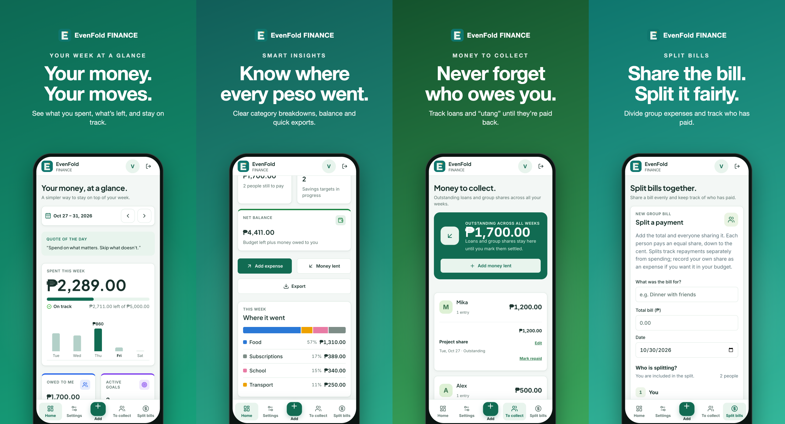
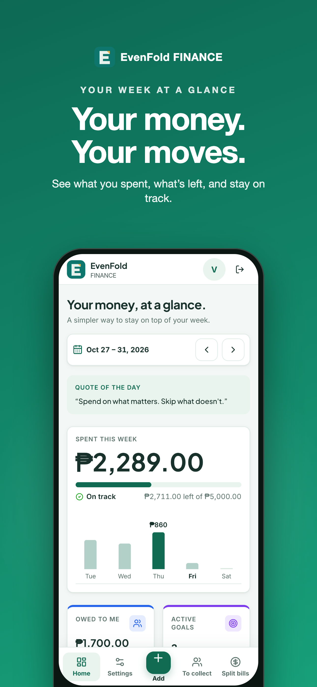
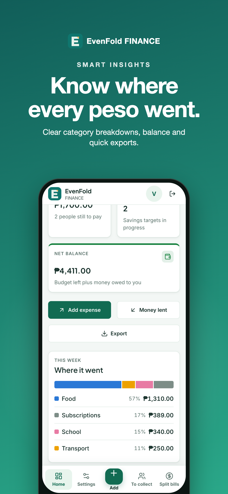
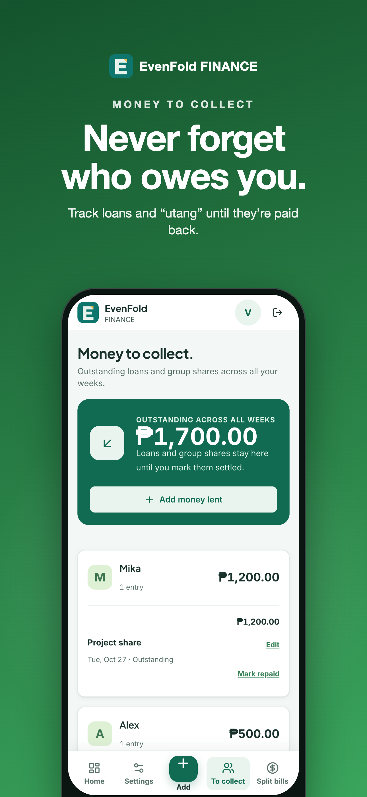
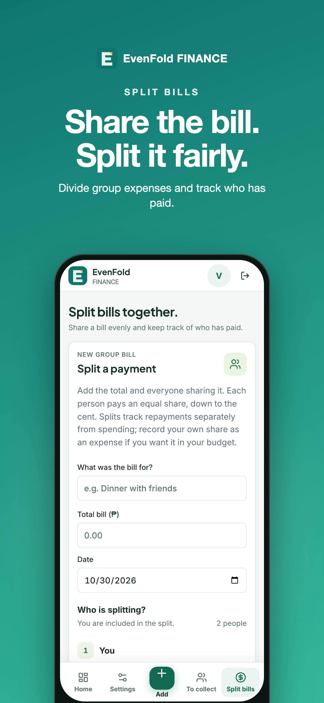

# EvenFold FINANCE

### Your money. Your moves. Your control.

**Make every peso count.**

 

**Track** &nbsp;·&nbsp; **Split** &nbsp;·&nbsp; **Save** &nbsp;·&nbsp; **Stay organized**

 

EvenFold FINANCE is a simple personal finance tracker. It helps you understand where your money goes, keep track of what others owe you, split expenses with friends, and work toward your financial goals.

---

## 📱 Screenshots

  

<table>
  <tr>
    <td></td>
    <td></td>
    <td></td>
    <td></td>
  </tr>
</table>

*Screenshots use sample demo data.*

---

## 🚀 Open the app

### [**Open EvenFold FINANCE →**](https://tarravictor.github.io/EvenFold-FINANCE/)

Sign in or create an account to get started.

---

## ✨ Features

| | Feature | What it does |
| :-: | :-- | :-- |
| 💸 | **Track expenses** | Record everyday spending and see how much you've spent each week. |
| 🤝 | **Track money lent** | Keep your loans, or "utang", in one place. See who borrowed, how much, and whether it's paid. |
| 🍽️ | **Split group bills** | Divide shared expenses and see how much each person needs to pay. |
| 🎯 | **Savings goals** | Create goals like an emergency fund or a new laptop and watch your progress. |
| 📊 | **Dashboard** | An organized view of your spending, loans, balances, and goals. |
| 📤 | **Export records** | Download supported records to keep a personal backup or review them elsewhere. |

<b>See the details for each feature</b>

 

**💸 Track your expenses**

Add expenses such as food and drinks, transportation, school expenses, shopping, subscriptions, bills, and other personal spending.

**🤝 Track money you've lent**

Lent money to a friend or classmate? You can record:

- Who borrowed the money
- How much they borrowed
- What the money was for
- When you lent it
- Whether it has been paid

**🍽️ Split group expenses**

Use the **Group Bill Splitter** for group meals, school projects, trips, shared purchases, and other group expenses.

**🎯 Set financial goals**

Save for an emergency fund, a new phone or laptop, school expenses, travel, personal purchases, or general savings.

---

## 🧭 Getting started

1. **Open the website** using the link above.
2. **Create your account** or sign in.
3. **Add your first expense.**
4. Record any money you've lent to other people.
5. Create group bills when splitting expenses.
6. Set the financial goals you want to reach.
7. Check your dashboard regularly to monitor your finances.

---

## 🔒 Account and privacy

- Each user has their own EvenFold FINANCE account, and your records are connected to it.
- Use your own login and keep your password private.
- Always sign out on a shared or public computer.
- Please review the app's **Privacy Policy** and **Terms & Conditions** before creating an account.

---

## 🛠️ Built with

Charts come from **Recharts**, PDF reports from **jsPDF**, and the interface uses **Radix UI** components.

---

## 💬 Need help?

If you run into a problem or have a question, contact the developer directly.

| | |
| :-- | :-- |
| **Developer** | Victor Tarra |
| **Email** | [tarra.victor.c@gmail.com](mailto:tarra.victor.c@gmail.com) |

When reporting an issue, include a short description of what happened and, if you can, a screenshot.

> [!WARNING]
> Please **do not send your password or other sensitive account information** by email.

---

## ⚠️ Important reminder

> [!IMPORTANT]
> EvenFold FINANCE is a **personal finance tracking tool**. What it shows is based on the records you enter, so make sure your amounts and details are correct.
>
> It does not provide professional financial, accounting, tax, or investment advice.

---

## 💚 About

> **"Your money. Your moves. Your control. Make every peso count."**
>
> — Victor Tarra, Creator

EvenFold FINANCE was created to make personal money management easier, without complicated spreadsheets or financial software.

---

### Ready to start?

 

**EvenFold FINANCE**

Created by **Victor Tarra** · Built with **Claude Code** & **Codex**

For support: [tarra.victor.c@gmail.com](mailto:tarra.victor.c@gmail.com)

© 2026 EvenFold Finance. All rights reserved.

